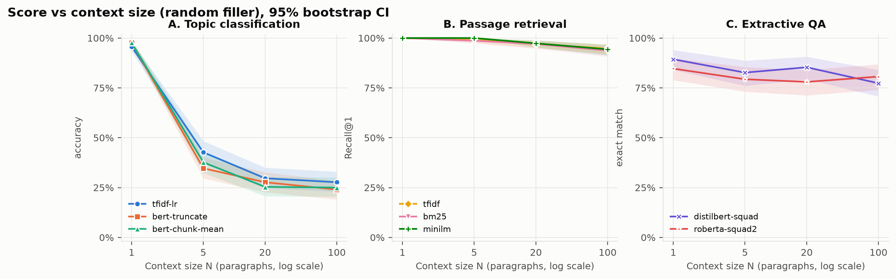

# Semantic Saturation Benchmark (SSB)

> **Does adding more textual context improve an NLP model's understanding? Is there a
> point where more context starts to make it less reliable?**

SSB keeps the **signal paragraph fixed** and adds paragraphs around it. It then measures
whether classic NLP models stay correct *and* well calibrated. There are no large
language models and no text generation: only TF-IDF, BM25 and BERT-family encoders, on
three kinds of "understanding".

**Status: v0.1 in progress.** The dataset builder, model runner, analysis and report are
done and pass an end-to-end smoke run on CPU. The full run (300 examples per task) is
next, on a T4. The results section is written by `ssb report` from the actual run.

(An earlier LLM-based version of this benchmark is preserved on the
[`llm-v0.1`](../../tree/llm-v0.1) branch.)

## Method

| Task | Data | Signal | Contradiction | Models |
|---|---|---|---|---|
| A. Topic classification | AG News (4 classes) | one test article, unedited | an article from another class | TF-IDF + logistic regression; BERT fine-tuned on AG News, with `truncate` (first 512 tokens) and `chunk-mean` (average logits over 512-token chunks) |
| B. Passage retrieval | SQuAD 2.0 dev, answerable | the question's source paragraph | gold copy with the answer entity swapped (spaCy NER) | TF-IDF, BM25, all-MiniLM-L6-v2 |
| C. Extractive QA | SQuAD 2.0 dev, answerable + unanswerable | the source paragraph | same NER-swapped copy | distilbert-base-cased-distilled-squad, deepset/roberta-base-squad2 (sliding window 384/128) |

**Context size.** N ∈ {1, 5, 20, 100} paragraphs of about 120 tokens (108–132,
bert-base-uncased), up to about 12k tokens. A context never holds less than its own
evidence: five copies at N = 1 are five paragraphs. This way every example appears at
every N, and curves always compare the same examples. Every sample's token count is
stored.

**Axes.** One varies at a time; the base context is the signal plus random filler.

| Axis | What changes | Levels |
|---|---|---|
| Dilution | Only N (one signal paragraph, so the signal ratio is 1/N) | N |
| Semantic noise | Filler becomes hard negatives: the paragraphs most similar to the query (all-mpnet-base-v2, not an evaluated model) that don't contain the answer | random vs hard |
| Redundancy | The signal appears k times | k ∈ {1, 5}; exact copies vs back-translated paraphrases (MarianMT en→fr→en) |
| Contradiction | One conflicting paragraph next to the signal | before / after |
| Position | Where the signal sits | depth 0, 0.5, 1 |

Random filler is Wikipedia: SQuAD 2.0 *train* paragraphs, whose 442 articles share no
title with the 35 dev articles.

**Guarantees, checked at build time and in `tests/`:**
- The signal is present and byte-identical to the source data in every sample.
- Paragraph counts, token counts and depths match the condition.
- In B and C, the answer appears only in signal copies, never in filler.
- An NER-swapped copy no longer contains the answer but does contain its replacement
  entity.
- A cross-class article has a different label.
- Every paraphrase keeps the answer span (B/C), or keeps the label according to a
  separate AG News classifier (A); the ones that don't are dropped.

**Hypotheses** are pre-registered in [HYPOTHESES.md](HYPOTHESES.md).

## Reproduce

```bash
python -m venv .venv && . .venv/bin/activate        # Python 3.11–3.13
pip install -e ".[analysis,dev]"
pytest                                                # dataset invariants, metrics, resume

# smoke test (CPU): 20 base examples per task
ssb build  --config configs/smoke.yaml
ssb run    --config configs/smoke.yaml
ssb report --config configs/smoke.yaml

# full v0.1 (one T4): print the runtime estimate, then run
ssb run    --config configs/main.yaml --estimate
ssb run    --config configs/main.yaml
ssb report --config configs/main.yaml                 # fills the results section below
```

The committed `data/ssb_v0.1.jsonl` (SHA-256 hashes in its manifest) is the canonical
dataset. `ssb build --config configs/main.yaml` regenerates it, but back-translation and
embeddings can differ slightly between GPU and CPU builds, so runs read the committed
file. `ssb run` can always be resumed: predictions are appended and fsynced after each
batch, and a rerun skips finished samples. On Kaggle, `kaggle/run.py` runs build, run and
report on a T4 (`kaggle kernels push -p kaggle --accelerator NvidiaTeslaT4`).

<!-- results:start -->
## Results (main run)

**Answer:** More context did not help: 8 of 8 models got significantly worse from N=1 to N=100 (largest drop: bert-truncate, 73.7 points). Repeating the signal 5 times significantly softened the drop for 4 of 8 models.



### Leaderboard

SSS is the normalised area under score vs log N (1 = perfect at every N); N* is where the gain from the previous N drops below 1 point; N† is the first N significantly below the curve's peak (bootstrap, Holm, p < 0.05).

| task | model | axis | SSS [95% CI] | N* | N† |
|---|---|---|---|---|---|
| classification | tfidf-lr | Dilution (random filler) | 0.451 [0.416, 0.486] | 5 | 5 |
| classification | tfidf-lr | Hard-negative noise | 0.895 [0.867, 0.922] | 5 | 5 |
| classification | tfidf-lr | Redundancy k=5, copies | 0.681 [0.653, 0.709] | 5 | 20 |
| classification | tfidf-lr | Redundancy k=5, paraphrases | 0.679 [0.649, 0.707] | 5 | 20 |
| classification | tfidf-lr | Contradiction | 0.341 [0.303, 0.378] | 5 | 5 |
| classification | tfidf-lr | Position d=0.5 | 0.321 [0.279, 0.363] | 20 | 20 |
| classification | bert-truncate | Dilution (random filler) | 0.415 [0.376, 0.452] | 5 | 5 |
| classification | bert-truncate | Hard-negative noise | 0.660 [0.624, 0.698] | 5 | 5 |
| classification | bert-truncate | Redundancy k=5, copies | 0.644 [0.615, 0.673] | 5 | 20 |
| classification | bert-truncate | Redundancy k=5, paraphrases | 0.634 [0.606, 0.663] | 5 | 20 |
| classification | bert-truncate | Contradiction | 0.432 [0.385, 0.481] | 5 | 5 |
| classification | bert-truncate | Position d=0.5 | 0.241 [0.195, 0.285] | 20 | 20 |
| classification | bert-chunk-mean | Dilution (random filler) | 0.419 [0.383, 0.457] | 5 | 5 |
| classification | bert-chunk-mean | Hard-negative noise | 0.682 [0.648, 0.718] | 5 | 5 |
| classification | bert-chunk-mean | Redundancy k=5, copies | 0.628 [0.601, 0.658] | 5 | 20 |
| classification | bert-chunk-mean | Redundancy k=5, paraphrases | 0.630 [0.603, 0.658] | 5 | 20 |
| classification | bert-chunk-mean | Contradiction | 0.348 [0.310, 0.388] | 5 | 5 |
| classification | bert-chunk-mean | Position d=0.5 | 0.251 [0.208, 0.298] | 20 | >100 |
| retrieval | tfidf | Dilution (random filler) | 0.978 [0.964, 0.989] | 5 | 5 |
| retrieval | tfidf | Hard-negative noise | 0.853 [0.819, 0.888] | 5 | 5 |
| retrieval | tfidf | Redundancy k=5, copies | 0.983 [0.974, 0.991] | 5 | 20 |
| retrieval | tfidf | Redundancy k=5, paraphrases | 0.984 [0.975, 0.992] | 5 | 20 |
| retrieval | tfidf | Contradiction | 0.657 [0.606, 0.709] | 5 | 20 |
| retrieval | tfidf | Position d=0.5 | 0.968 [0.950, 0.984] | 20 | 20 |
| retrieval | bm25 | Dilution (random filler) | 0.975 [0.960, 0.987] | 5 | 5 |
| retrieval | bm25 | Hard-negative noise | 0.870 [0.836, 0.902] | 5 | 5 |
| retrieval | bm25 | Redundancy k=5, copies | 0.981 [0.971, 0.990] | 5 | 20 |
| retrieval | bm25 | Redundancy k=5, paraphrases | 0.982 [0.972, 0.991] | 5 | 20 |
| retrieval | bm25 | Contradiction | 0.582 [0.533, 0.629] | 5 | 100 |
| retrieval | bm25 | Position d=0.5 | 0.965 [0.946, 0.981] | 20 | 20 |
| retrieval | minilm | Dilution (random filler) | 0.981 [0.971, 0.990] | 5 | 20 |
| retrieval | minilm | Hard-negative noise | 0.722 [0.677, 0.768] | 5 | 5 |
| retrieval | minilm | Redundancy k=5, copies | 0.984 [0.975, 0.991] | 5 | 20 |
| retrieval | minilm | Redundancy k=5, paraphrases | 0.985 [0.977, 0.993] | 5 | 20 |
| retrieval | minilm | Contradiction | 0.594 [0.537, 0.647] | 5 | 20 |
| retrieval | minilm | Position d=0.5 | 0.971 [0.956, 0.985] | 20 | 20 |
| qa | distilbert-squad | Dilution (random filler) | 0.838 [0.785, 0.884] | 5 | 5 |
| qa | distilbert-squad | Hard-negative noise | 0.693 [0.637, 0.749] | 5 | 5 |
| qa | distilbert-squad | Redundancy k=5, copies | 0.857 [0.806, 0.901] | 5 | 100 |
| qa | distilbert-squad | Redundancy k=5, paraphrases | 0.833 [0.782, 0.881] | 5 | >100 |
| qa | distilbert-squad | Contradiction | 0.543 [0.491, 0.598] | 5 | 100 |
| qa | distilbert-squad | Position d=0.5 | 0.825 [0.770, 0.878] | 100 | 100 |
| qa | roberta-squad2 | Dilution (random filler) | 0.801 [0.743, 0.853] | 5 | 5 |
| qa | roberta-squad2 | Hard-negative noise | 0.780 [0.723, 0.835] | 5 | 5 |
| qa | roberta-squad2 | Redundancy k=5, copies | 0.809 [0.753, 0.860] | 5 | >100 |
| qa | roberta-squad2 | Redundancy k=5, paraphrases | 0.786 [0.724, 0.839] | 5 | >100 |
| qa | roberta-squad2 | Contradiction | 0.520 [0.454, 0.588] | 5 | >100 |
| qa | roberta-squad2 | Position d=0.5 | 0.833 [0.776, 0.884] | 100 | >100 |

### Pre-registered hypotheses

Verdicts follow the tests fixed in [HYPOTHESES.md](HYPOTHESES.md). Differences in points with 95% bootstrap CIs over base examples; * = Holm-significant.

|  | hypothesis | verdict | evidence |
|---|---|---|---|
| H1 | All models degrade as N grows; hard negatives hurt more than random noise | **partly supported** | degrades: 8/8, hard worse: 5/8. tfidf-lr: N=1→100 +68.0 [+62.3, +73.3], random−hard -56.3 [-62.0, -49.7]; bert-truncate: N=1→100 +73.7 [+68.7, +78.7], random−hard -20.7 [-26.0, -16.0]; bert-chunk-mean: N=1→100 +72.7 [+67.3, +78.0], random−hard -20.7 [-25.3, -16.7]; tfidf: N=1→100 +5.3 [+3.0, +8.0], random−hard +17.0 [+13.0, +21.3]; bm25: N=1→100 +6.3 [+3.7, +9.3], random−hard +14.3 [+10.3, +18.3]; minilm: N=1→100 +5.7 [+3.3, +8.7], random−hard +28.7 [+23.3, +33.7]; distilbert-squad: N=1→100 +12.0 [+6.0, +18.0], random−hard +28.0 [+20.0, +36.7]; roberta-squad2: N=1→100 +4.0 [+0.6, +8.5], random−hard +8.0 [+3.2, +13.4] |
| H2 | Bag-of-words models show no position bias; truncating BERT collapses past 512 tokens | **supported** | tfidf-lr: d0−d0.5 +0.0 [+0.0, +0.0], d0−d1 +0.0 [+0.0, +0.0]; tfidf: d0−d0.5 +0.0 [+0.0, +0.0], d0−d1 +0.0 [+0.0, +0.0]; bm25: d0−d0.5 +0.0 [+0.0, +0.0], d0−d1 +0.0 [+0.0, +0.0]; bert-truncate N=100: d0 53.7%, d0.5 23.3%, d1 23.3% |
| H3 | Chunk-mean fixes position bias but still degrades from dilution | **supported** | position d0−d0.5 +0.0 [+0.0, +0.0], d0−d1 +0.0 [+0.0, +0.0]; dilution N=1→100 +72.7 [+67.3, +78.0] |
| H4 | BM25/TF-IDF beat the dense encoder on hard negatives; dense wins on random noise | **partly supported** | bm25>minilm hard: +13.7 [+7.7, +19.0] *; minilm>bm25 random: +0.7 [-2.3, +4.0]; tfidf>minilm hard: +12.0 [+6.0, +17.7] *; minilm>tfidf random: -0.3 [-3.3, +2.7] |
| H5 | Redundancy slows degradation; copies help TF-IDF, paraphrases help transformers | **not supported** | slows degradation for 4/8 models; tfidf-lr copy−paraphrase gain +0.3 [+0.0, +1.0]; tfidf copy−paraphrase gain -0.7 [-1.7, +0.0]; bert-truncate paraphrase−copy gain -2.3 [-4.7, -0.3]; bert-chunk-mean paraphrase−copy gain +0.0 [+0.0, +0.0]; minilm paraphrase−copy gain +1.0 [+0.0, +2.3]; distilbert-squad paraphrase−copy gain +5.3 [-1.3, +12.0]; roberta-squad2 paraphrase−copy gain -2.7 [-7.6, +2.1] |
| H6 | QA models pick the conflicting answer about half the time; position matters | **partly supported (distilbert-squad)** | conflict share +33.5 [+28.1, +38.2]%; before − after +19.6 [+8.8, +29.7] pts (p=0.000) |
| H6 | QA models pick the conflicting answer about half the time; position matters | **partly supported (roberta-squad2)** | conflict share +30.9 [+25.1, +36.8]%; before − after +10.7 [+0.1, +21.1] pts (p=0.048) |
| H7 | Confidence stays high while accuracy drops | **partly supported** | tfidf-lr: overconfidence change +53.0 [+47.2, +58.4] pts; bert-truncate: overconfidence change +72.4 [+67.6, +77.4] pts; bert-chunk-mean: overconfidence change +73.3 [+68.2, +78.2] pts; distilbert-squad: overconfidence change +13.5 [+7.2, +20.2] pts; roberta-squad2: overconfidence change +1.9 [-3.1, +7.1] pts |
| H8 | Unanswerable questions get more false answers as N grows | **partly supported** | no-answer accuracy drop N=1→100: dilution +0.7 [-4.1, +5.8] pts, noise +6.7 [+0.0, +14.0] pts |

### Figures

- [Noise types](figures/fig2_noise_types.png)
- [Position heatmap](figures/fig3_position_heatmap.png)
- [Redundancy](figures/fig4_redundancy.png)
- [Contradiction outcomes](figures/fig5_contradiction.png)
- [Calibration](figures/fig6_calibration.png)
- [Leaderboard](figures/fig7_leaderboard.png)

<details><summary>All dilution and noise points</summary>

| model | metric | filler | N | score [95% CI] | ECE |
|---|---|---|---|---|---|
| tfidf-lr | accuracy | random | 1 | 95.7% [93.3%, 98.0%] | 0.051 |
| tfidf-lr | accuracy | random | 5 | 42.7% [37.0%, 48.3%] | 0.283 |
| tfidf-lr | accuracy | random | 20 | 29.7% [24.7%, 35.0%] | 0.459 |
| tfidf-lr | accuracy | random | 100 | 27.7% [23.0%, 33.0%] | 0.479 |
| tfidf-lr | accuracy | hard | 1 | 95.7% [93.3%, 98.0%] | 0.051 |
| tfidf-lr | accuracy | hard | 5 | 90.0% [86.3%, 93.3%] | 0.037 |
| tfidf-lr | accuracy | hard | 20 | 88.7% [84.7%, 92.0%] | 0.060 |
| tfidf-lr | accuracy | hard | 100 | 84.0% [79.7%, 88.0%] | 0.096 |
| bert-truncate | accuracy | random | 1 | 97.7% [96.0%, 99.3%] | 0.010 |
| bert-truncate | accuracy | random | 5 | 34.7% [29.7%, 40.0%] | 0.609 |
| bert-truncate | accuracy | random | 20 | 27.7% [22.7%, 32.7%] | 0.694 |
| bert-truncate | accuracy | random | 100 | 24.0% [19.0%, 28.3%] | 0.734 |
| bert-truncate | accuracy | hard | 1 | 97.7% [96.0%, 99.3%] | 0.010 |
| bert-truncate | accuracy | hard | 5 | 70.0% [64.7%, 75.0%] | 0.237 |
| bert-truncate | accuracy | hard | 20 | 56.3% [50.3%, 62.0%] | 0.351 |
| bert-truncate | accuracy | hard | 100 | 44.7% [39.3%, 50.3%] | 0.476 |
| bert-chunk-mean | accuracy | random | 1 | 97.7% [96.0%, 99.3%] | 0.010 |
| bert-chunk-mean | accuracy | random | 5 | 37.7% [32.3%, 43.3%] | 0.455 |
| bert-chunk-mean | accuracy | random | 20 | 25.3% [20.7%, 30.3%] | 0.724 |
| bert-chunk-mean | accuracy | random | 100 | 25.0% [20.3%, 30.0%] | 0.743 |
| bert-chunk-mean | accuracy | hard | 1 | 97.7% [96.0%, 99.3%] | 0.010 |
| bert-chunk-mean | accuracy | hard | 5 | 78.7% [74.0%, 83.3%] | 0.107 |
| bert-chunk-mean | accuracy | hard | 20 | 54.0% [48.3%, 59.7%] | 0.364 |
| bert-chunk-mean | accuracy | hard | 100 | 45.7% [40.0%, 51.3%] | 0.494 |
| tfidf | Recall@1 | random | 1 | 100.0% [100.0%, 100.0%] | n/a |
| tfidf | Recall@1 | random | 5 | 99.0% [97.7%, 100.0%] | n/a |
| tfidf | Recall@1 | random | 20 | 97.0% [95.0%, 98.7%] | n/a |
| tfidf | Recall@1 | random | 100 | 94.7% [92.0%, 97.0%] | n/a |
| tfidf | Recall@1 | hard | 1 | 100.0% [100.0%, 100.0%] | n/a |
| tfidf | Recall@1 | hard | 5 | 85.7% [81.3%, 89.7%] | n/a |
| tfidf | Recall@1 | hard | 20 | 81.0% [76.3%, 85.7%] | n/a |
| tfidf | Recall@1 | hard | 100 | 77.7% [73.0%, 82.7%] | n/a |
| bm25 | Recall@1 | random | 1 | 100.0% [100.0%, 100.0%] | n/a |
| bm25 | Recall@1 | random | 5 | 98.7% [97.3%, 99.7%] | n/a |
| bm25 | Recall@1 | random | 20 | 97.0% [94.7%, 98.7%] | n/a |
| bm25 | Recall@1 | random | 100 | 93.7% [90.7%, 96.3%] | n/a |
| bm25 | Recall@1 | hard | 1 | 100.0% [100.0%, 100.0%] | n/a |
| bm25 | Recall@1 | hard | 5 | 87.7% [83.7%, 91.3%] | n/a |
| bm25 | Recall@1 | hard | 20 | 83.3% [79.0%, 87.7%] | n/a |
| bm25 | Recall@1 | hard | 100 | 79.3% [74.7%, 84.0%] | n/a |
| minilm | Recall@1 | random | 1 | 100.0% [100.0%, 100.0%] | n/a |
| minilm | Recall@1 | random | 5 | 100.0% [100.0%, 100.0%] | n/a |
| minilm | Recall@1 | random | 20 | 97.3% [95.3%, 99.0%] | n/a |
| minilm | Recall@1 | random | 100 | 94.3% [91.3%, 96.7%] | n/a |
| minilm | Recall@1 | hard | 1 | 100.0% [100.0%, 100.0%] | n/a |
| minilm | Recall@1 | hard | 5 | 67.3% [62.0%, 72.7%] | n/a |
| minilm | Recall@1 | hard | 20 | 65.7% [60.3%, 71.3%] | n/a |
| minilm | Recall@1 | hard | 100 | 65.7% [60.3%, 71.3%] | n/a |
| distilbert-squad | exact match | random | 1 | 89.3% [84.0%, 94.0%] | 0.129 |
| distilbert-squad | exact match | random | 5 | 82.7% [76.0%, 88.7%] | 0.127 |
| distilbert-squad | exact match | random | 20 | 85.3% [79.3%, 90.7%] | 0.136 |
| distilbert-squad | exact match | random | 100 | 77.3% [70.7%, 84.0%] | 0.147 |
| distilbert-squad | exact match | hard | 1 | 89.3% [84.0%, 94.0%] | 0.129 |
| distilbert-squad | exact match | hard | 5 | 73.3% [66.7%, 80.0%] | 0.103 |
| distilbert-squad | exact match | hard | 20 | 65.3% [57.3%, 72.7%] | 0.212 |
| distilbert-squad | exact match | hard | 100 | 49.3% [41.3%, 57.3%] | 0.401 |
| roberta-squad2 | exact match | random | 1 | 84.7% [78.9%, 89.9%] | 0.146 |
| roberta-squad2 | exact match | random | 5 | 79.3% [73.1%, 85.4%] | 0.129 |
| roberta-squad2 | exact match | random | 20 | 78.0% [71.2%, 84.0%] | 0.118 |
| roberta-squad2 | exact match | random | 100 | 80.7% [74.0%, 86.9%] | 0.155 |
| roberta-squad2 | exact match | hard | 1 | 84.7% [78.9%, 89.9%] | 0.146 |
| roberta-squad2 | exact match | hard | 5 | 78.0% [71.2%, 84.4%] | 0.139 |
| roberta-squad2 | exact match | hard | 20 | 77.3% [70.5%, 83.7%] | 0.148 |
| roberta-squad2 | exact match | hard | 100 | 72.7% [65.5%, 79.5%] | 0.121 |

</details>

### Run details

- Device: Tesla T4; torch 2.11.0+cu130, transformers 5.23.0.
- Runtime: 0.55 h in total; per model (s): {'tfidf-lr': 44.5, 'bert-truncate': 157.5, 'bert-chunk-mean': 698.9, 'tfidf': 10.8, 'bm25': 8.3, 'minilm': 3.6, 'distilbert-squad': 339.3, 'roberta-squad2': 706.8}.
- Raw predictions: `results/main/predictions/`; per-answer scores: `results/main/scores.parquet`; every metric with CIs: `results/main/metrics.parquet`.
<!-- results:end -->

## Related work

- **Lost in the Middle** (Liu et al., TACL 2024, [arXiv:2307.03172](https://arxiv.org/abs/2307.03172)):
  LLM accuracy on multi-document QA and key-value retrieval is U-shaped in the position
  of the relevant passage, and gains saturate long before retriever recall does.
- **LLMs Can Be Easily Distracted by Irrelevant Context** (Shi et al., ICML 2023,
  [arXiv:2302.00093](https://arxiv.org/abs/2302.00093)): GSM-IC adds irrelevant sentences
  to arithmetic problems, and accuracy drops sharply.
- **Adversarial Examples for Evaluating Reading Comprehension Systems** (Jia & Liang,
  EMNLP 2017, [arXiv:1707.07328](https://arxiv.org/abs/1707.07328)): one inserted
  distracting sentence cuts SQuAD F1 from 75% to 36% on average across 16 models.
- **BEIR** (Thakur et al., NeurIPS 2021 Datasets & Benchmarks,
  [arXiv:2104.08663](https://arxiv.org/abs/2104.08663)): across 18 retrieval datasets,
  BM25 is a robust zero-shot baseline that dense retrievers often fail to beat.

**What SSB adds:** quantity, relevance, redundancy, conflict and position as
**independent controlled axes**, across three task types (classification, retrieval,
QA). It also measures **reliability** (calibration, abstention, conflict behaviour),
not just accuracy.

## Limitations

- English only.
- The perturbations are controlled but partly synthetic: entity swaps and
  back-translations.
- Contexts reach at most about 12k tokens.
- Encoder models only.
- Hard negatives depend on the selector encoder.
- AG News signals are shorter than the 120-token filler, because the signal is never
  edited.

## Roadmap

- More datasets (IMDB, HotpotQA).
- Longformer/BigBird for long inputs.
- More N values.
- Multilingual (French, Arabic, Tamazight).
- Multiple seeds.

## License

MIT
